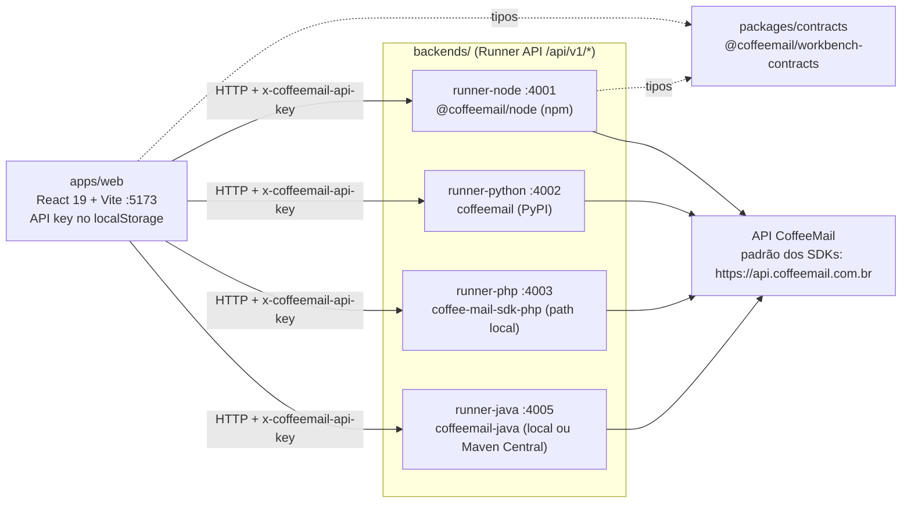

<div align="center">

# ☕ CoffeeMail SDK Workbench

**Bancada interna, guiada por spec, para exercitar e comparar os SDKs oficiais da CoffeeMail (Node.js, Python, PHP e Java) a partir de uma única UI.**

[](https://github.com/Coffee-Mail/coffee-mail-sdk-workbench/actions/workflows/ci.yml)
[](./pnpm-workspace.yaml)
[](./specs/openapi.json)
[](#-licença)

[Visão geral](#-visão-geral) · [Arquitetura](#️-arquitetura) · [Início rápido](#-início-rápido) · [Endpoints](#-endpoints) · [Adicionar um runner](#adicionando-um-novo-runner) · [Scripts](#-scripts)

</div>

---

## 📑 Sumário

- [✨ Visão geral](#-visão-geral)
- [🚦 Status do projeto](#-status-do-projeto)
- [🏗️ Arquitetura](#️-arquitetura)
- [🗂️ Estrutura do repositório](#️-estrutura-do-repositório)
- [📋 Requisitos](#-requisitos)
- [🚀 Início rápido](#-início-rápido)
- [⚙️ Configuração](#️-configuração)
- [🌐 Endpoints](#-endpoints)
- [🔒 Segurança](#-segurança)
- [🧰 Scripts](#-scripts)
- [🧪 Testes e qualidade](#-testes-e-qualidade)
- [🩺 Solução de problemas](#-solução-de-problemas)
- [🤝 Contribuição](#-contribuição)
- [🔗 Projetos relacionados](#-projetos-relacionados)
- [📄 Licença](#-licença)

## ✨ Visão geral

O Workbench é um monorepo pnpm que valida o comportamento dos SDKs da CoffeeMail seguindo Spec-Driven Development:

- [`specs/SPEC.md`](./specs/SPEC.md) e [`specs/openapi.json`](./specs/openapi.json) definem a **Runner API**, um contrato HTTP agnóstico de linguagem.
- Cada `backends/runner-<lang>` é um mini-backend que implementa essa Runner API chamando o SDK da sua linguagem.
- Uma única UI React (`apps/web`, porta `5173`) dispara as operações contra o runner selecionado e mostra o envelope de resposta, o tempo de execução (`executionTimeMs`) e a versão do SDK que respondeu.
- A API key é digitada na UI, salva no `localStorage` do navegador e enviada a cada requisição pelo header `x-coffeemail-api-key`. Os runners não guardam credenciais.
- Os DTOs e a tabela de endpoints compartilhados entre a UI e o runner Node ficam em [`packages/contracts`](./packages/contracts) (`@coffeemail/workbench-contracts`).

| Runner | Porta | Stack | SDK consumido | Origem do SDK |
| --- | --- | --- | --- | --- |
| `runner-node` | `4001` | Express 4 + tsx | `@coffeemail/node` `^0.2.1` | Registro npm (lockfile em `0.2.1`) |
| `runner-python` | `4002` | FastAPI + uvicorn (uv) | `coffeemail` `>=0.1.0` | PyPI (`uv.lock` em `0.1.0`) |
| `runner-php` | `4003` | Servidor embutido `php -S` | `coffeemail/coffeemail-php` `@dev` | **Caminho local** `../../../coffee-mail-sdk-php` (repositório `path`, symlink) |
| `runner-java` | `4005` | Javalin 7 (Gradle 9.8.1) | `br.com.coffeemail:coffeemail-java` `0.1.0` | Composite build de `../../../coffee-mail-sdk-java` se o diretório existir; senão Maven Central |
| Go | `4004` | — | — | Planejado; não existe runner no repo |

### Abas da UI

| Aba | Operações | Rotas da Runner API |
| --- | --- | --- |
| Introspecção | Valida a chave e mostra ambiente, permissões e prévia da chave | `POST /api/v1/client/introspect` |
| E-mails | Envio e listagem paginada | `POST /api/v1/emails/send`, `GET /api/v1/emails` |
| Domínios | Cadastro, listagem, verificação de DNS e saúde | `/api/v1/domains`, `/domains/{id}/verify`, `/domains/{id}/health` |
| Modelos | Cadastro, listagem e preview | `/api/v1/templates`, `/templates/{id}/preview` |
| Audiências e Contatos | Audiências, listagem e inclusão de contatos | `/api/v1/audiences`, `/audiences/{id}/contacts` |
| Supressões | Listar, adicionar e remover | `/api/v1/suppressions`, `/suppressions/{email}` |
| Webhooks | Listar, criar e disparar teste | `/api/v1/webhooks`, `/webhooks/{id}/test` |
| Estatísticas | Métricas agregadas por intervalo | `GET /api/v1/stats` |

## 🚦 Status do projeto

Ferramenta interna (`"private": true`), sem release nem publicação. Limitações conhecidas, conferidas no código:

- **Node e Python testam o SDK publicado**, não o código local: `runner-node` resolve `@coffeemail/node` pelo npm e `runner-python` resolve `coffeemail` pelo PyPI. Para validar uma mudança ainda não publicada nesses SDKs é preciso apontar a dependência manualmente para o caminho local.
- **PHP depende do repositório irmão**: sem `coffee-mail-sdk-php` em `../coffee-mail-sdk-php` (relativo à raiz do workbench), `composer install` em `runner-php` falha.
- **Só a API de produção.** Os runners sempre falam com `https://api.coffeemail.com.br`: nenhum SDK permite trocar o host da API, para que a chave nunca seja enviada a outro servidor. Não há como apontar a bancada para uma API local.
- **Go aparece na UI e na spec, mas não está implementado**: selecioná-lo resulta em runner desconectado.
- **Cobertura parcial da spec**: a matriz da SPEC §3 lista operações (batch, broadcasts, rotação de secret, logs de entrega etc.) que nenhum runner expõe. Os runners implementam as 22 rotas listadas em [Endpoints](#-endpoints).
- **`specs/openapi.json` descreve só 10 dos paths** implementados pelos runners (faltam as rotas com `{id}`/`{email}`).
- **Status HTTP divergentes entre runners**: Node e Java devolvem 201 nas criações, 400 com `VALIDATION_ERROR` quando faltam campos e 400 em falha do SDK. Python e PHP não fazem essa validação prévia e devolvem HTTP 200 mesmo quando o SDK falha (o erro vem só no envelope, com `success: false`); ausência de API key gera 400 em ambos.
- **CI só cobre a parte TypeScript** (`contracts`, `runner-node`, `web`); os testes de Python e Java rodam apenas localmente e o runner PHP não tem testes.

## 🏗️ Arquitetura



Fluxo de uma operação:

1. A UI monta `${runnerUrl}${endpoint}` e envia o JSON com `x-coffeemail-api-key` (`apps/web/src/hooks/useRunnerApi.ts`).
2. O runner cria um cliente do SDK **por requisição** com a chave recebida (Node e Java com locale `pt-BR`), executa a operação e mede o tempo.
3. O runner responde sempre no envelope padronizado da SPEC §5.2:

```json
{
  "success": true,
  "runner": { "language": "java", "runtime": "Java 21", "sdkVersion": "0.1.0", "status": "online" },
  "executionTimeMs": 42,
  "data": {},
  "error": null
}
```

Em falha, `success` é `false` e `error` traz `{ code, message, status, details }`. Nos runners Node e Java, erros de validação usam `code: "VALIDATION_ERROR"` e HTTP 400.

O runner Node segue a separação controller → service → adapter (`ICoffeeMailSdkAdapter`), o que permite testar o service com um adapter falso.

## 🗂️ Estrutura do repositório

```text
coffee-mail-sdk-workbench/
├── .github/workflows/ci.yml        # Build + typecheck + test (pnpm, Node 22)
├── specs/
│   ├── SPEC.md                     # Especificação da Runner API (headers, envelope, cobertura)
│   ├── openapi.json                # OpenAPI 3.1 da Runner API (servers 4001–4005)
│   └── DX_EVOLUTION_SPEC.md        # RFC de evolução de DX do @coffeemail/node
├── packages/
│   └── contracts/                  # DTOs, RUNNER_ENDPOINTS e RUNNER_HEADERS
├── backends/
│   ├── runner-node/                # Express: controllers, services, adapters, __tests__
│   ├── runner-python/              # FastAPI: server.py, tests/, pyproject.toml, uv.lock
│   ├── runner-php/                 # server.php, composer.json (repo path para o SDK local)
│   └── runner-java/                # Javalin + Gradle wrapper; src/main e src/test
├── apps/
│   └── web/                        # React 19 + Vite: modules/ (uma aba por recurso), hooks/, constants/
├── package.json                    # Scripts do monorepo
├── pnpm-workspace.yaml             # packages/*, backends/*, apps/*
└── tsconfig.base.json
```

Os runners Python, PHP e Java têm um `package.json` mínimo só para participar do workspace e serem acionados por `pnpm --filter`.

## 📋 Requisitos

| Ferramenta | Versão | Necessária para |
| --- | --- | --- |
| Node.js | 22 (usado no CI; nenhum `engines` declarado no repo) | Monorepo, `runner-node`, `web` |
| pnpm | 11 (CI fixa `11.26.0`; `pnpm-workspace.yaml` usa `allowBuilds` e `minimumReleaseAgeExclude`) | Todos os scripts |
| Python + [uv](https://docs.astral.sh/uv/) | Python `>=3.10` | `runner-python` |
| PHP + Composer | PHP `^8.2` com `ext-curl` e `ext-json` | `runner-php` |
| JDK | 17+ para executar o Gradle; o toolchain Java 21 é baixado automaticamente (plugin foojay) | `runner-java` |
| Repositórios irmãos | `coffee-mail-sdk-php` (obrigatório para PHP); `coffee-mail-sdk-java` (opcional) | `runner-php`, `runner-java` |

Layout de diretórios esperado pelos caminhos relativos:

```text
<workspace>/
├── coffee-mail-sdk-workbench/
├── coffee-mail-sdk-php/       # exigido por backends/runner-php/composer.json
└── coffee-mail-sdk-java/      # usado por backends/runner-java/settings.gradle.kts se existir
```

## 🚀 Início rápido

```bash
git clone git@github.com:Coffee-Mail/coffee-mail-sdk-workbench.git
git clone git@github.com:Coffee-Mail/coffee-mail-sdk-php.git
cd coffee-mail-sdk-workbench

pnpm install
pnpm build

(cd backends/runner-php && composer install)
```

O runner Python não exige passo extra: `uv run` cria o `.venv` e sincroniza o `uv.lock` na primeira execução. O runner Java baixa Gradle, JDK 21 e dependências na primeira execução.

Subir tudo (Node, Python, PHP, Java e UI em paralelo):

```bash
pnpm dev
```

`pnpm dev` exige todos os toolchains. Sem algum deles, suba só o que precisa:

```bash
pnpm dev:web
pnpm dev:backend
pnpm dev:runner-python
pnpm dev:runner-php
pnpm dev:runner-java
```

Uso da UI:

1. Abra `http://localhost:5173`.
2. Cole a API key no cabeçalho. Ela fica no `localStorage` (`coffeemail_workbench_api_key`), assim como o runner escolhido (`coffeemail_workbench_runner_url`).
3. Escolha o runner no seletor e clique em **Testar Conexão** (`GET /api/v1/runner/info`).
4. Navegue pelas abas e use **Executar no SDK**; o painel mostra o envelope bruto e o tempo de execução.

Chamada direta a um runner, sem UI:

```bash
curl -s -X POST http://localhost:4005/api/v1/client/introspect \
  -H "x-coffeemail-api-key: $COFFEEMAIL_API_KEY"
```

## ⚙️ Configuração

O workbench não usa arquivo de credenciais. A configuração é por header de requisição e pela porta de cada runner.

### Headers da Runner API

| Header | Obrigatório | Suporte | Descrição |
| --- | --- | --- | --- |
| `x-coffeemail-api-key` | Sim, nas operações autenticadas | Todos os runners | Chave CoffeeMail usada para instanciar o SDK naquela requisição |
| `Authorization: Bearer <key>` | Não | Só `runner-php` (fallback) | Alternativa ao header acima |

### Variáveis de ambiente

| Variável | Runner | Obrigatória | Default | Descrição |
| --- | --- | --- | --- | --- |
| `PORT` | `runner-node` | Não | `4001` | Porta HTTP; lida via `dotenv` de `backends/runner-node/.env` (modelo em `.env.example`) |
| `PORT` | `runner-java` | Não | `4005` | Porta HTTP; valores não numéricos são ignorados |

As portas de Python (`4002`) e PHP (`4003`) estão fixas nos scripts do `package.json` de cada runner. A UI (`5173`, `host: true`) está em `apps/web/vite.config.ts`. A lista de runners da UI está em `DEFAULT_RUNNERS` (`apps/web/src/constants/ui-strings.ts`); mudar a porta de um runner exige atualizar essa lista.

## 🌐 Endpoints

Rotas implementadas pelos quatro runners (prefixo `/api/v1`, CORS liberado para qualquer origem). As colunas de status e validação descrevem Node e Java; Python e PHP respondem 200 e não validam campos antes de chamar o SDK (ver [Status do projeto](#-status-do-projeto)):

| Método | Rota | Status de sucesso | Validação do runner |
| --- | --- | --- | --- |
| `GET` | `/runner/info` | 200 | — |
| `POST` | `/client/introspect` | 200 | — |
| `POST` | `/emails/send` | 200 | `from`, `to`, `subject` |
| `GET` | `/emails` | 200 | `page`, `limit` (query) |
| `GET` | `/domains` | 200 | — |
| `POST` | `/domains` | 201 | `name` |
| `POST` | `/domains/{id}/verify` | 200 | — |
| `GET` | `/domains/{id}/health` | 200 | — |
| `GET` | `/templates` | 200 | `page`, `limit` (query) |
| `POST` | `/templates` | 201 | `name`, `subject`, `html` |
| `POST` | `/templates/{id}/preview` | 200 | — |
| `GET` | `/audiences` | 200 | — |
| `POST` | `/audiences` | 201 | `name` |
| `GET` | `/audiences/{id}/contacts` | 200 | `page`, `limit` (query) |
| `POST` | `/audiences/{id}/contacts` | 201 | `email` |
| `GET` | `/suppressions` | 200 | `page`, `limit` (query) |
| `POST` | `/suppressions` | 201 | `email`, `reason` |
| `DELETE` | `/suppressions/{email}` | 200 | — |
| `GET` | `/webhooks` | 200 | — |
| `POST` | `/webhooks` | 201 | `url`, `events` (array não vazio) |
| `POST` | `/webhooks/{id}/test` | 200 | — |
| `GET` | `/stats` | 200 | `startDate`, `endDate`, `period` (query) |

A tabela segue `backends/runner-node/src/routes/index.ts` e `backends/runner-java/.../RunnerRoutes.java`. Em Node e Java, falhas do SDK voltam como HTTP 400 com o erro mapeado no envelope; exceções não tratadas voltam como 500 em todos os runners.

Tipos em TypeScript: `RUNNER_ENDPOINTS` e `RUNNER_HEADERS` em `packages/contracts/src/endpoints.ts`, DTOs em `packages/contracts/src/dtos.ts`.

### Adicionando um novo runner

Passo a passo seguido na entrada do runner Java (commits `8a5d893` e `75a5986`):

1. **Crie `backends/runner-<lang>/`** com o servidor HTTP implementando as rotas da tabela acima sob `/api/v1`, com CORS liberado e aceitando o header `x-coffeemail-api-key`.
2. **Instancie o SDK por requisição** a partir de `x-coffeemail-api-key`, sem configurar host da API. Não leia chave de `.env` nem guarde credenciais.
3. **Responda no envelope da SPEC §5.2** (`success`, `runner`, `executionTimeMs`, `data`, `error`), com `runner.language` igual ao id do runner e `sdkVersion` vinda do SDK. Replique as validações e os status HTTP do runner Node (400 `VALIDATION_ERROR`, 201 nas criações).
4. **Adicione `backends/runner-<lang>/package.json`** com `name` (ex.: `@coffeemail/workbench-runner-<lang>`), `"private": true` e scripts `dev`/`start` que sobem o servidor na porta escolhida. Inclua `test` ou `build` só se devem rodar no `pnpm -r` do CI.
5. **Registre no monorepo** (`package.json` raiz): script `dev:runner-<lang>` com `pnpm --filter <name> dev` e um `--filter <name>` a mais no script `dev`.
6. **Registre na UI**: entrada em `DEFAULT_RUNNERS` (`apps/web/src/constants/ui-strings.ts`) com `id`, `label` e `url`.
7. **Registre no contrato**: id na união `RunnerLanguage` (`packages/contracts/src/dtos.ts`) e um item em `servers` de `specs/openapi.json`.
8. **Escreva testes** do runner e documente-os em [Testes e qualidade](#-testes-e-qualidade) e neste README.
9. Valide com `pnpm build && pnpm typecheck && pnpm test` e exercite as abas pela UI contra o novo runner.

A porta `4004` está reservada para Go na UI e no `openapi.json`.

## 🔒 Segurança

- A API key vive só no `localStorage` do navegador de quem usa a UI e trafega em texto puro por HTTP local até o runner. Use chaves de teste e não exponha os runners fora de `localhost`: o Vite sobe com `host: true` e os runners escutam em todas as interfaces (PHP e Python em `0.0.0.0`) com CORS `*`.
- Os runners não persistem credenciais nem respostas.
- `backends/runner-node/.env` está no `.gitignore`; o único valor previsto é `PORT`.

## 🧰 Scripts

### Raiz (`package.json`)

| Script | Comando | O que faz |
| --- | --- | --- |
| `dev` | `pnpm --parallel --filter … dev` | Sobe `runner-node`, `runner-python`, `runner-php`, `runner-java` e `web` |
| `dev:backend` | `pnpm --filter @coffeemail/runner-node dev` | Só o runner Node (`tsx watch`) |
| `dev:runner-python` | `pnpm --filter @coffeemail/runner-python dev` | Só o runner Python (uvicorn com `--reload`) |
| `dev:runner-php` | `pnpm --filter @coffeemail/workbench-runner-php dev` | Só o runner PHP |
| `dev:runner-java` | `pnpm --filter @coffeemail/workbench-runner-java dev` | Só o runner Java (`./gradlew run`) |
| `dev:web` | `pnpm --filter @coffeemail/workbench-web dev` | Só a UI (Vite) |
| `build` | `pnpm --recursive run build` | `tsc` em `contracts` e `runner-node`; `tsc && vite build` na `web` |
| `typecheck` | `pnpm --recursive run typecheck` | `tsc --noEmit` em `contracts`, `runner-node` e `web` |
| `test` | `pnpm --recursive run test` | Vitest do `runner-node` (único pacote com script `test`) |
| `test:jvm` | `pnpm --filter @coffeemail/workbench-runner-java test:jvm` | `./gradlew test` do runner Java |

### Por pacote

| Pacote | Scripts |
| --- | --- |
| `@coffeemail/workbench-contracts` | `build`, `typecheck` |
| `@coffeemail/runner-node` | `dev`, `build`, `start` (`node dist/index.js`), `test`, `typecheck` |
| `@coffeemail/runner-python` | `dev`, `start` |
| `@coffeemail/workbench-runner-php` | `dev`, `start` (ambos `php -S 0.0.0.0:4003 server.php`) |
| `@coffeemail/workbench-runner-java` | `dev`, `start`, `test:jvm` |
| `@coffeemail/workbench-web` | `dev`, `build`, `preview`, `typecheck` |

## 🧪 Testes e qualidade

| Alvo | Comando | Onde roda |
| --- | --- | --- |
| `runner-node` (Vitest, service com adapter falso) | `pnpm test` | Local e CI |
| `runner-python` (pytest + `TestClient`) | `cd backends/runner-python && uv run --with pytest pytest` | Só local (pytest não está nas dependências do runner) |
| `runner-java` (JUnit 6 + AssertJ, Javalin em porta efêmera) | `pnpm test:jvm` | Só local |
| `runner-php` | — | Sem testes |

O runner Java compila com `--release 17`, `-Xlint:all` e `-Werror`.

CI ([`.github/workflows/ci.yml`](./.github/workflows/ci.yml)), em push e PR para `main`: pnpm `11.26.0`, Node 22, `pnpm install --frozen-lockfile`, `pnpm run build`, `pnpm run typecheck`, `pnpm run test`.

Gate local antes de abrir PR:

```bash
pnpm build && pnpm typecheck && pnpm test
```

## 🩺 Solução de problemas

| Sintoma | Causa provável | Ação |
| --- | --- | --- |
| UI mostra "Runner Desconectado" | Runner não está de pé ou porta diferente da de `DEFAULT_RUNNERS` | Suba o runner (`pnpm dev:<runner>`) e use **Testar Conexão** |
| Runner Go sempre desconectado | Não existe implementação | Esperado; escolha outro runner |
| `composer install` falha em `runner-php` | `coffee-mail-sdk-php` não está ao lado do workbench | Clone o SDK PHP no diretório pai |
| `typecheck` da `web` ou do `runner-node` falha com módulo `@coffeemail/workbench-contracts` não encontrado | `packages/contracts/dist` ainda não foi gerado | Rode `pnpm build` antes de `pnpm typecheck` (é a ordem do CI) |
| Mudança local no SDK Node/Python não aparece | Runners resolvem a versão publicada | Aponte a dependência para o caminho local ou publique a versão |
| Mudança local no SDK Java não aparece | `coffee-mail-sdk-java` ausente no diretório pai, então o Gradle usa o Maven Central | Clone o SDK ao lado do workbench |
| Erro "Chave de API não informada" | Header `x-coffeemail-api-key` ausente ou vazio | Preencha a API key na UI |

## 🤝 Contribuição

- Spec primeiro: mudanças no contrato entram em `specs/SPEC.md`/`specs/openapi.json` e em `packages/contracts` antes dos runners e da UI.
- Paridade: uma rota nova precisa existir em todos os runners com a mesma validação, status HTTP e envelope.
- Convenções da casa: código em inglês, prosa e commits em pt-BR, sem comentários, sem `any`, early return em vez de `else`, sem magic strings.
- Commits no padrão Conventional Commits em pt-BR (ex.: `feat(runner-java): …`), um PR por mudança contra `main`.

## 🔗 Projetos relacionados

| Repositório | Papel |
| --- | --- |
| [coffee-mail-sdk-node](https://github.com/Coffee-Mail/coffee-mail-sdk-node) | SDK oficial Node.js/TypeScript (`@coffeemail/node`) |
| [coffee-mail-sdk-python](https://github.com/Coffee-Mail/coffee-mail-sdk-python) | SDK oficial Python (`coffeemail`) |
| [coffee-mail-sdk-php](https://github.com/Coffee-Mail/coffee-mail-sdk-php) | SDK oficial PHP (`coffeemail/coffeemail-php`) |
| [coffee-mail-sdk-java](https://github.com/Coffee-Mail/coffee-mail-sdk-java) | SDK oficial Java (`br.com.coffeemail:coffeemail-java`) |
| [coffee-mail-laravel](https://github.com/Coffee-Mail/coffee-mail-laravel) | Integração Laravel (`coffeemail/coffeemail-laravel`) |
| **coffee-mail-sdk-workbench** (você está aqui) | Bancada de validação dos SDKs por spec |

## 📄 Licença

O repositório não tem arquivo `LICENSE` e não declara licença em nenhum manifesto. Na ausência de licença explícita, nenhum direito de uso, cópia ou distribuição é concedido além do que os mantenedores da CoffeeMail autorizarem.
